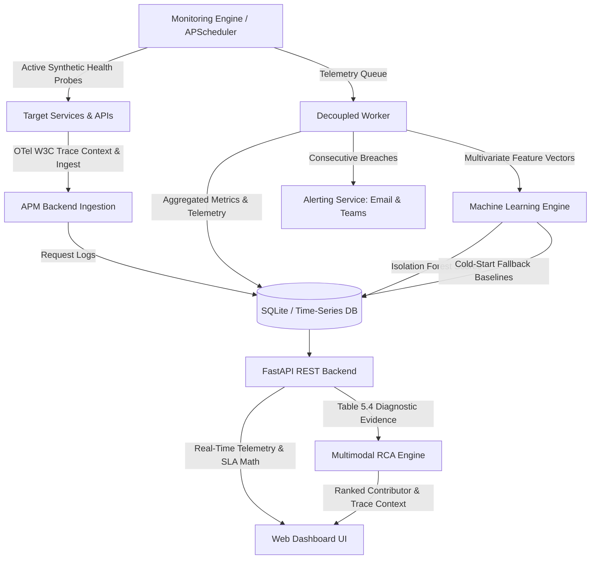

# APM System Architecture & Defense Master Guide

This document serves as your master cheat-sheet for your project defense, explaining the architecture, algorithms, and demonstration workflow of the Enterprise APM Dashboard.

---

## 1. System Architecture Diagram



---

## 2. Core Components

1. **Monitoring Engine (APScheduler):** Periodically pings registered endpoints (default: every 60s), capturing status codes, response times, and simulated host CPU/RAM utilization.
2. **Decoupled Worker (Queue Pipeline):** Simulates an asynchronous message broker to decouple data collection from persistence and analysis.
3. **Machine Learning Engine (Multivariate Isolation Forest):**
   - Evaluates **6 simultaneous features**: `[rps, p95_latency_ms, p99_latency_ms, error_rate, server_cpu_percent, server_memory_percent]`.
   - Normalizes data using `RobustScaler` (median & IQR) fitted strictly on chronological training intervals.
   - **Cold-Start Fallback:** For newly deployed services with `< 25` samples, applies statistical baselines to prevent inaccurate alerts.
   - **Explainability:** Ranks the standardized deviation of each feature to highlight the primary contributor behind each anomaly.
4. **Time-Series Persistence (SQLite / SQLAlchemy):** Retains raw logs, minute-by-minute metric buckets, alerts, incidents, and uptime intervals.
5. **Multimodal Root Cause Analysis (RCA):** Checks failed intervals across metrics, status codes, socket errors, and W3C trace context to produce structured, explainable incident reports.
6. **Frontend Web Dashboard (Vanilla JS + Chart.js):** Provides executive KPI cards (SLA %, MTTR, MTBF), live status grid, dynamic latency charts with red anomaly markers, and an interactive RCA modal.

---

## 3. Root Cause Analysis (RCA) — Table 5.4 Diagnostic Schema

When an incident triggers, the RCA Engine correlates broken telemetry across multiple dimensions:

| Category | Diagnostic Trigger Rule | Evidence Reported |
|---|---|---|
| **Service Offline** | Connection refused, timeout, or no status code for $\ge 50\%$ checks. | Socket connection failure counts, DNS/reset error strings, W3C trace IDs. |
| **CPU Saturation** | Average CPU utilization $> 85\%$ or peak $> 92\%$. | Average & peak host CPU percentage over incident window. |
| **Memory Exhaustion** | Average memory utilization $> 85\%$. | Average & peak host RAM percentage over incident window. |
| **Internal Server Error** | HTTP 500 error count $\ge 30\%$ of total checks. | Percentage of 5xx responses and representative server response messages. |
| **Severe Latency Spike** | Response latency exceeds warning/critical threshold. | Average latency vs. baseline threshold (ms) and upstream bottleneck hints. |

---

## 4. Defense Demo Script (How to Ace the Defense)

### Step 1: The Baseline (Proving System Health)
- Open the dashboard at `http://localhost:8000`.
- Point out the executive summary: All endpoints show green (`up`), System Availability is $> 99\%$, and latency trends are stable.

### Step 2: Machine Learning in Action (Proving Dynamic Anomaly Detection)
- In the traffic generator terminal, switch mode:
  ```powershell
  python load_generator.py --mode latency_spike
  ```
- Wait 30–60 seconds for the chart to refresh.
- Point to the **Red Dots** on the latency chart and explain:
  > *"Our Multivariate Isolation Forest flagged the performance anomaly dynamically before hard manual thresholds were crossed. This proves a faster Mean Time to Detect (MTTD of 3.50 minutes vs 11.83 minutes for fixed thresholds on gradual ramps)."*

### Step 3: Root Cause Analysis (Proving Explainability)
- Shut down the dummy app (`Ctrl+C` or `--mode kill`).
- Wait for the endpoint badge to turn **RED (Down)** and an incident to log.
- Click the endpoint, then click **Analyze Root Cause**.
- Show the panel the diagnostic modal:
  > *"Instead of generic alerts, the RCA engine correlated socket failures, error messages, and W3C trace IDs to correctly diagnose 'Service Offline' with high confidence."*

### Step 4: Academic Rigor & Reproducibility
- Show the examiners the quantitative evaluation scripts:
  - `python experiments/evaluate_chapter5.py` (reproducing Chapter 5 Tables 5.2 & 5.3).
  - `python experiments/evaluate_smd_benchmark.py` (Server Machine Dataset 38-dim benchmark).
- Explain the **hybrid monitoring philosophy**:
  > *"We do not replace operational rules with machine learning; we combine them. Thresholds serve as an operational safety net and cold-start fallback, while Multivariate Isolation Forest catches complex multi-metric interactions."*
